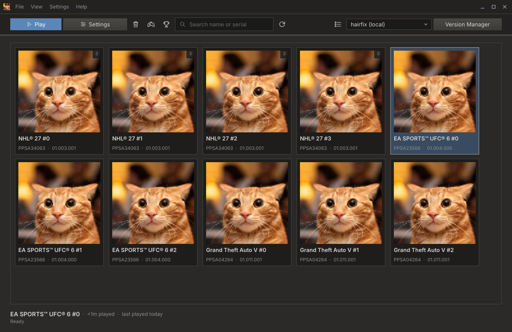
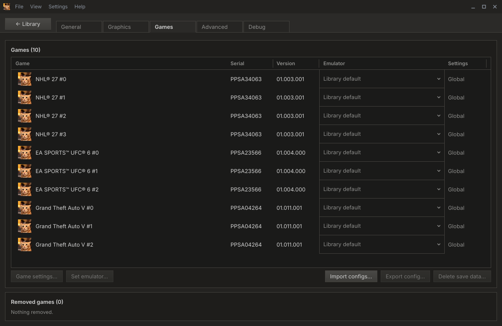
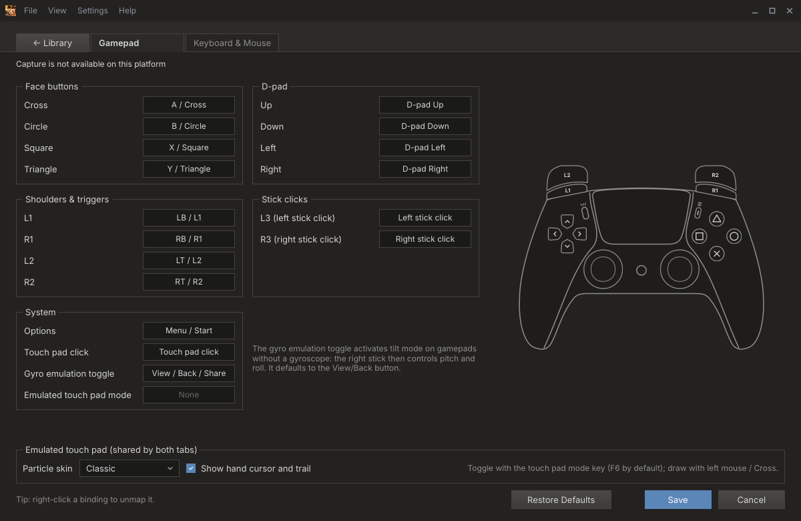

# KytyPS5 Slint Launcher

A fast, single-exe launcher for the [KytyPS5](https://github.com/KytyPS5/KytyPS5) emulator, written in C++ with
[Slint](https://slint.dev). It replaces the Qt launcher and reads its `Kyty.ini`, saves, trophies and cheats, so you
can switch over without losing anything.



<p>
   Games: a build drop-down for every game" width="49%">
  
</p>

- [Features](#features)
- [Getting started](#getting-started)
- [Help and troubleshooting](#help-and-troubleshooting)
- [Building the launcher](#building-the-launcher)
- [Releases](#releases)

Guides:
- [Configs.md](Configs.md): config files. How build makers ship `cfgGlobal.json` / `cfg<TITLEID>.json`, every
  setting key, and the per-game and import/export formats.
- [Themes.md](Themes.md): making your own colour theme.

## Features

This launcher covers what the upstream Qt launcher does: library with list and grid views, global and per-game
settings, input mapping with a live controller diagram, cheats, trophy viewer, compatibility status, Additional
Content, Compress to ZAR, game config import/export, remove save data and a built-in updater. Below is only what
is different.

**New here**
- **One small exe, no Qt.** Static runtime on Windows, so no DLLs or VC++ redistributable to install.
- **Version Manager.** Download KytyPS5 releases from GitHub and keep several builds side by side, switch builds
  from the toolbar, add other GitHub repositories as release sources, add local builds, and rename, pin, hide or
  delete them. Checks for newer `-latest` builds at start-up and hourly. An optional GitHub token is kept in
  Windows Credential Manager, never in the settings file.
- **Per-game build pin.** **Settings > Games** lists every game with an Emulator drop-down: leave it on the
  library default or pick any installed build. A Settings column shows which games have their own settings.
- **Build cfg files.** A build can ship `cfgGlobal.json` and `cfg<TITLEID>.json` with the settings it needs; the
  launcher applies them and warns when one overrides your setting. See [Configs.md](Configs.md).
- **Per-game settings show the real values**, including anything the build's cfg files force.
- **More emulator options**: environment variables for the emulator (global or per game), extra arguments, and
  switches the Qt launcher has no checkbox for (splash screen, VR, PlayGo hack, GPU-assisted validation, graphics
  debug dump).
- **Play time and last played** per game, **Pin to top** favourites, a remembered sort order, and hiding games
  from the list (restorable in **Settings > Games**).
- **Console window** with the emulator's live output and the full last log.
- **`--dry-run`** prints exactly what would be launched (config layers, command line, environment), and
  **`--play`** launches without a window.
- **First-start setup**: pick the theme, app data or portable mode, your game folders, where saves go and the
  add-ons folder, and import the Qt launcher's `Kyty.ini` and game list in one step (also later from
  **File > Import Kyty.ini...**).
- **Portable mode**: put a `portable.txt` next to the exe and everything stays in that folder.
- **Themes**: dark, light and classic built in. See [Themes.md](Themes.md) to make your own.

**Works differently**
- Settings are saved as JSON (`kyty.json` and `configs/games/<TITLEID>.json`) instead of `Kyty.ini`. Your
  `Kyty.ini` is read but never changed.
- The updater updates this launcher from this repository's releases.

**Not ported yet**
- The game's title music, the borderless fullscreen option and the "System" theme.

## Getting started

1. Download the launcher from [Releases](https://github.com/pengui07/KytyPS5-Slint-Launcher/releases) and
   start it. The first-start window asks for:
   - **Theme**, applied as you pick it.
   - **Launcher data**: *App data* (recommended) or *Next to the launcher* (portable).
   - **Game folders**, the **run folder** where saves and trophies go (*Recommended* picks the Qt launcher's
     folder when there is one), and the **add-ons folder**.
   - If a Qt launcher `Kyty.ini` was found, whether to import its settings and game list.
2. Open the **Version Manager** and download a build, or use **Add Custom** to point at a `kyty_emulator` you
   already have.
3. Your games appear in the library; double-click one to play. Add more game folders any time in
   **Settings > General**.

### Where files live

| | App data (Windows) | Portable | Linux | macOS |
|---|---|---|---|---|
| Settings `kyty.json` | `%LOCALAPPDATA%\KytyPS5\configs\` | `<launcher>\configs\` | `~/.config/kytyps5/` | `~/Library/Application Support/KytyPS5/configs/` |
| Per-game settings | `configs\games\<TITLEID>.json` | same | `~/.config/kytyps5/games/` | same pattern |
| Builds, cache, logs | `%LOCALAPPDATA%\KytyPS5\versions`, `cache`, `logs` | `<launcher>\...` | `~/.local/share/kytyps5/` | `~/Library/Application Support/KytyPS5/` |
| Saves, trophies, cheats | `<run folder>\_SaveData`, `_Trophies`, `_Patches` | | | |

Portable mode is on whenever a file named `portable.txt` sits next to the launcher exe. On Linux the
`XDG_CONFIG_HOME` and `XDG_DATA_HOME` variables are honoured.

## Help and troubleshooting

**First stop: the Console and the last log.** Open **View > Console**. It shows the emulator's output live, and
*Last log* loads the full output of the previous run from `logs/last-run.log`.

**See exactly what will be launched.** Run the launcher from a terminal with `--dry-run`:

```
kyty_slint_launcher.exe --dry-run            # print to the terminal
kyty_slint_launcher.exe --dry-run plan.txt   # or write it to a file
```

It prints the config layers that were applied (and how many keys each one set), the exe, working folder, full
command line and environment, plus any warnings. This is the best thing to paste into a bug report.
`--play` launches the last selected game without a window.

**Common problems**

- **"A setting I changed is ignored."** The selected build probably ships a `cfgGlobal.json` or
  `cfg<TITLEID>.json` that sets that option. Build cfg files outrank your global settings. The console and
  `--dry-run` print a warning such as *this build's config files set vblank_frequency over the saved value*.
  To override it for one game, change it in that game's **Game settings** (per-game settings win over build
  files), or use a different build. [Configs.md](Configs.md) explains the layers.
- **"Pinned emulator ... is missing, using default."** The build a game was pinned to was deleted or moved.
  Re-pin the game in **Settings > Games**.
- **A game is missing from the library.** Check that its folder is under one of your game folders and contains
  `eboot.bin`, or is a `.zar` archive. If you removed it from the list, restore it in **Settings > Games**.
- **A game can't have its own settings / cheats / trophies.** Those are keyed by the title ID in
  `sce_sys/param.json`. Games without one can't have them. Cheats are only for PS5 titles
  (`PPSA` + 5 digits).
- **A cheat file is refused.** The online file must match the game's title ID, installed version and executable,
  and use only plain memory writes. Master codes and module-specific cheats aren't supported by the emulator yet.
- **Version Manager says GitHub's rate limit was hit.** Add a GitHub token in **Settings > Advanced**, or set
  `GITHUB_TOKEN` / `GH_TOKEN`. Without network the last fetched release list is shown with its age.
- **Settings didn't load: "is from a newer launcher".** `kyty.json` was written by a newer launcher. This one
  uses defaults and won't overwrite the file. Update the launcher.
- **Moving from the Qt launcher later.** Use **File > Import Kyty.ini...**. Your `Kyty.ini` is never changed.

When reporting a bug, include the `--dry-run` output, `logs/last-run.log`, the build name from the Version
Manager, and the game's title ID.

## Building the launcher

Requirements:
- CMake >= 3.21, Ninja (or a Visual Studio generator)
- A C++20 compiler: MSVC, clang-cl, GCC or Clang
- Rust >= 1.92 (Slint is built from source)
- Linux: libcurl and libfontconfig1 dev packages

```
cmake -B build -G Ninja -DCMAKE_BUILD_TYPE=Release
cmake --build build
```

On Windows, run these from an "x64 Native Tools Command Prompt for VS". The exe ends up in `build/`. On Windows it
links the static VC++ runtime, so it needs no redistributable (turn off `KYTY_SLINT_STATIC_CRT` to change that).

A local build is a development build: it never updates itself.

## Releases

Push a version tag to publish a release:

```
git tag v1.2.0
git push origin v1.2.0
```

`.github/workflows/release.yml` builds Windows and Linux, stamps the tag into the launcher
(`-DKYTY_LAUNCHER_VERSION=v1.2.0`) and attaches `KytyPS5-Slint-Launcher-<tag>-Windows-x64.zip` and
`-Linux-x86_64.tar.gz` to the release. Released launchers look for a newer release at startup (**Settings >
General > Launcher**) and from **Help > Check for updates**, then download it, swap the executable and restart.
